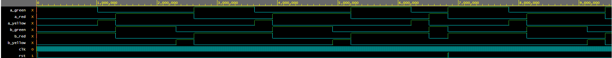

# Digital Traffic Light Controller (Verilog HDL)

**Open Hardware Nexus (OHN) – Paired GitHub Assignment**
Authors: Madandola James and 

## 1. Project overview and objectives
A Finite State Machine (FSM) based traffic light controller for a two-road intersection (Road A and Road B), written in Verilog and verified with a self-checking testbench. Objectives: research FSMs and counters, design and implement the controller, verify it in simulation, document it, and collaborate with GitHub (branches, issues, pull requests).

## 2. Problem statement and requirements
Design a controller for Road A and Road B, each with Red, Yellow and Green outputs.
1. Control two intersecting roads.
2. Independent R/Y/G outputs per road.
3. Never both Green at once.
4. Green → Yellow → Red (Yellow always first).
5. A Green ⇒ B Red, and vice-versa.
6. Runs continuously through a fixed sequence.
7. Implemented as an FSM.
8. Durations set by clock + counter.

| State | Road A | Road B | Duration |
|---|---|---|---|
| 1 | Green | Red | 10 s |
| 2 | Yellow | Red | 3 s |
| 3 | Red | Green | 10 s |
| 4 | Red | Yellow | 3 s |

## 3. FSM concepts applied
A **Moore** FSM (outputs depend only on the state) with 4 states, a state register, next-state logic and output logic (three-block style). Moore was chosen because lamp outputs must be glitch-free. Details: [docs/01_research.md](research/Task-1.md).

## 4. Design methodology
Specification → identify states → state diagram & table → timing calculation → Verilog → testbench → verification → documentation. See [research/Task-2-system-design.md](research/Task-2-system-design.md).

## 5. State diagram and transition table


| Current | time_up | Next | Road A | Road B |
|---|---|---|---|---|
| S1 A_GREEN | 0 / 1 | S1 / S2 | Green | Red |
| S2 A_YELLOW | 0 / 1 | S2 / S3 | Yellow | Red |
| S3 B_GREEN | 0 / 1 | S3 / S4 | Red | Green |
| S4 B_YELLOW | 0 / 1 | S4 / S1 | Red | Yellow |

`rst = 1` forces S1 from any state. Full table in [research/Task-2-system-design.md](research/Task-2-system-design.md).

## 6. Clock and timing mechanism
`cycles = seconds × CLK_FREQ`. A 32-bit counter increments each rising clock edge; when `count == cycles − 1` the FSM advances and the counter clears. With a 50 MHz clock, 10 s = 500,000,000 cycles and 3 s = 150,000,000 cycles. In simulation `CLK_FREQ = 10`, so 1 s = 10 clock cycles = 100 ns.

## 7. Verilog implementation overview
| File | Purpose |
|---|---|
| `src/traffic_light_controller.v` | FSM + counter design (parameters `CLK_FREQ`, `G_TIME`, `Y_TIME`) |
| `tb/tb_traffic_light_controller.v` | Self-checking testbench, generates clock, dumps `traffic_light.vcd` |

Ports: `clk`, `rst` (sync, active-high) in; `a_red, a_yellow, a_green, b_red, b_yellow, b_green` out.

## 8. Simulation procedure and results
**EDA Playground:** choose *Icarus Verilog*, paste the testbench in `testbench.sv` and the design in `design.sv`, tick *Open EPWave after run*, press Run.
**Local (Icarus Verilog + GTKWave):**
```bash
make sim        # compile and run
make wave       # open waveform in GTKWave
```
The testbench checks: correct sequence, exact duration of each state, never both Green, one colour per road, return to State 1 after a cycle, and mid-sequence reset.

Expected console result: `RESULT: ALL TESTS PASSED`.

**Results:** *(paste your console output and waveform screenshots here – save images in `sim/`)*

Expected behaviour for reference: 

## 9. Challenges and how they were addressed
*(Edit with your own experience. Suggestions:)*
- Simulating 10 s on a 50 MHz clock is far too long → made the clock frequency a parameter and simulate with `CLK_FREQ = 10`.
- Off-by-one in the counter → compare with `duration − 1` so each state lasts exactly `duration` cycles.
- Testbench race/glitches when sampling outputs → sample on the falling clock edge.
- Merge conflicts / branch workflow → small branches and PR reviews.

## 10. References and learning resources
See [research/Task-1.md](research/Task-1.md): HDLBits, EDA Playground

## 11. Repository structure and collaboration
```
research/  research, design, state diagram, 
simuations/   waveforms and results
```