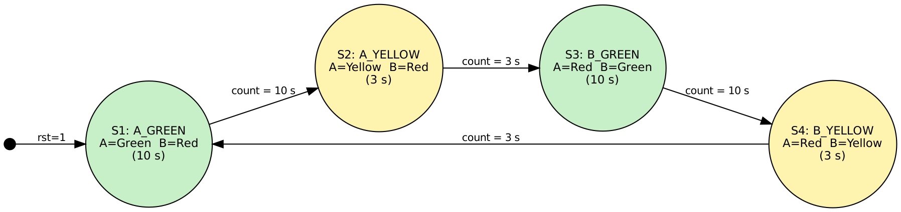
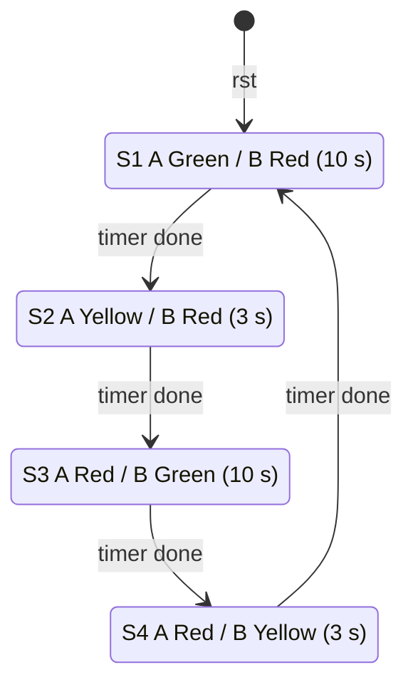

# Task 2 – System Design

## 1. Description of operation
The controller regulates a two-road intersection. A single clock drives an FSM with four states.
A counter counts clock cycles in each state; when the count reaches the state's duration the FSM moves
to the next state. After State 4 it returns to State 1 and repeats forever. A synchronous reset forces the system to State 1.

Safety rules enforced by construction (every state outputs exactly one colour per road):
- Both roads are never green together (only S1 and S3 have a green, and never in the same state).
- Green → Red always goes through Yellow (S1→S2 and S3→S4).
- When A is green, B is red and vice-versa.

## 2. FSM states
| State | Name | Road A | Road B | Duration |
|---|---|---|---|---|
| S1 | `S_A_GREEN`  (00) | Green  | Red    | 10 s |
| S2 | `S_A_YELLOW` (01) | Yellow | Red    | 3 s  |
| S3 | `S_B_GREEN`  (10) | Red    | Green  | 10 s |
| S4 | `S_B_YELLOW` (11) | Red    | Yellow | 3 s  |

## 3. State diagram


(Source: `state_diagram.dot`; regenerate with `dot -Tpng state_diagram.dot -o state_diagram.png`.)



## 4. State transition table
`time_up` = 1 when `count == state_cycles − 1`.

| Current state | rst | time_up | Next state | A (R/Y/G) | B (R/Y/G) |
|---|---|---|---|---|---|
| any   | 1 | x | S1 | – | – |
| S1    | 0 | 0 | S1 | 0 0 1 | 1 0 0 |
| S1    | 0 | 1 | S2 | 0 0 1 | 1 0 0 |
| S2    | 0 | 0 | S2 | 0 1 0 | 1 0 0 |
| S2    | 0 | 1 | S3 | 0 1 0 | 1 0 0 |
| S3    | 0 | 0 | S3 | 1 0 0 | 0 0 1 |
| S3    | 0 | 1 | S4 | 1 0 0 | 0 0 1 |
| S4    | 0 | 0 | S4 | 1 0 0 | 0 1 0 |
| S4    | 0 | 1 | S1 | 1 0 0 | 0 1 0 |

Outputs are the Moore outputs of the *current* state.

## 5. Timing mechanism
- Input clock frequency `CLK_FREQ` (Hz) is a parameter.
- `G_CYCLES = G_TIME × CLK_FREQ`, `Y_CYCLES = Y_TIME × CLK_FREQ`.
- A 32-bit counter `count` increments every rising edge; at `count == duration − 1` the state advances and `count` resets to 0.
  This gives each state exactly `duration` clock cycles.

| Clock | Green (10 s) | Yellow (3 s) |
|---|---|---|
| 50 MHz (real hardware) | 500,000,000 cycles | 150,000,000 cycles |
| 10 Hz (simulation, `CLK_FREQ=10`) | 100 cycles | 30 cycles |

## 6. Inputs and outputs
| Signal | Dir | Width | Description |
|---|---|---|---|
| `clk` | in | 1 | System clock, rising-edge active |
| `rst` | in | 1 | Synchronous reset, active-high → State 1 |
| `a_red`, `a_yellow`, `a_green` | out | 1 each | Road A lamps |
| `b_red`, `b_yellow`, `b_green` | out | 1 each | Road B lamps |

Parameters: `CLK_FREQ`, `G_TIME`, `Y_TIME`.

## 7. Block diagram
```
          +-----------------------------------------------+
 clk ---->|  state register  <--- next-state logic        |
 rst ---->|       |                    ^                  |
          |       v                    | time_up          |
          |  output logic (Moore)   duration lookup --> counter == dur-1
          +-------|---------------------------------------+
                  v
   a_red a_yellow a_green   b_red b_yellow b_green
```